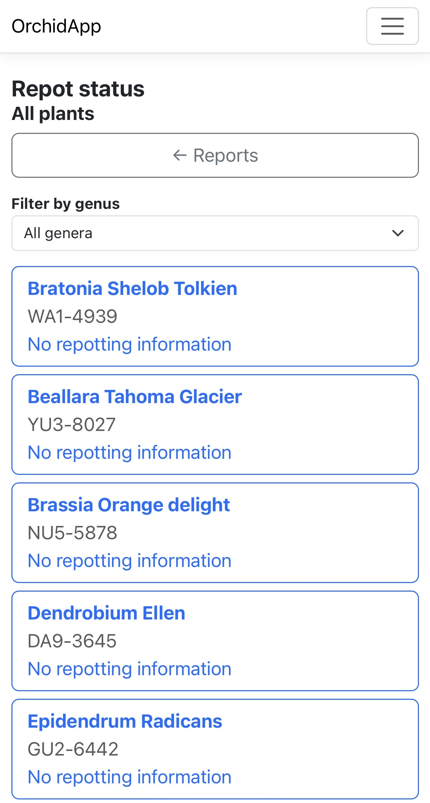
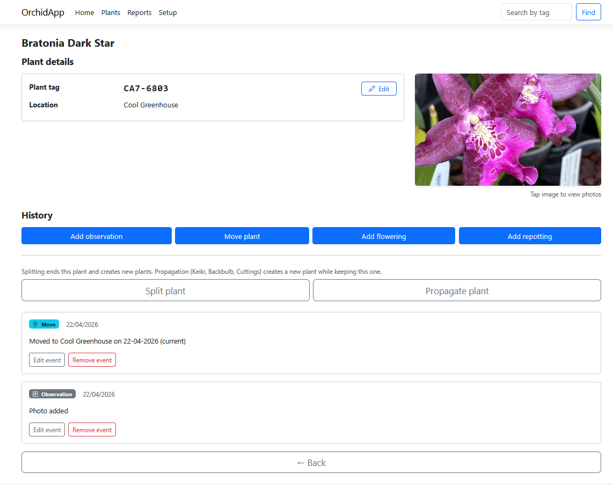
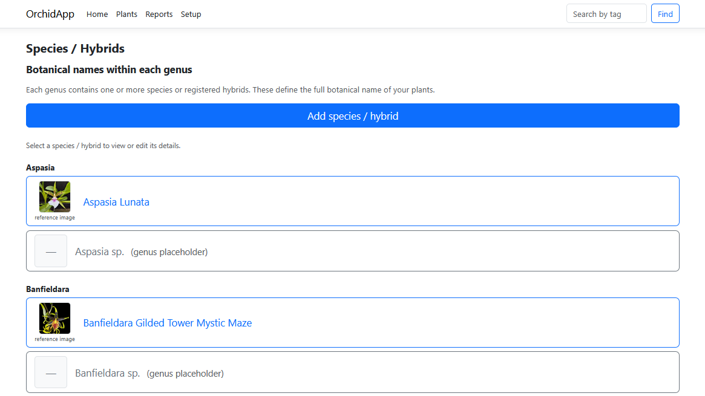
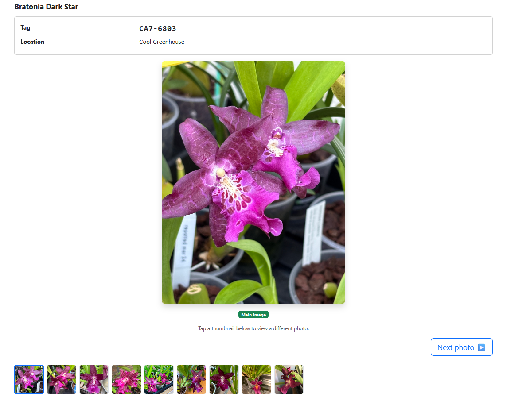

# OrchidApp

OrchidApp is a self-hosted orchid collection manager for plants, taxonomy, locations, observations, flowering, repotting, photos and lineage. It uses an ASP.NET Core Razor Pages web application (.NET 8) and MariaDB. Packaged Windows releases include a launcher and runtime components; Raspberry Pi/Linux deployments use an externally managed database and web service.

## Start here

- Users: [installation, first-use, backup and recovery guides](docs/index.md).
- Developers: [development machine and first run](docs/development-setup.md), then [contributing](CONTRIBUTING.md).
- Maintainers: [documentation ownership](docs/documentation-map.md), [database creation contract](docs/database-creation.md) and [open code changes](docs/code-change-backlog.md).
- Releases: [release notes](RELEASE_NOTES.md). Retired instructions and recent superseded deliveries are preserved in [documentation history](docs/history/index.md).

## Platforms and scope

| Role | Support and entry point |
| --- | --- |
| Windows application | Installer-led package; [Windows contract](docs/windows-upgrade-contract.md). Do not overwrite an installed app with a ZIP. |
| Raspberry Pi/Linux server | MariaDB and systemd; [installation and upgrade guide](docs/user-guides/linux/installation-upgrade.md). Current fresh-creation automation has documented blockers. |
| iPhone/iPad and Mac browsers | Clients connecting to an existing server; [iOS](docs/user-guides/ios/home-screen-web-app.md) and [Safari Dock](docs/user-guides/macos/safari-web-app.md) instructions. No standalone Mac server release is implied. |
| Owner's local environmental monitoring | Bespoke to one installation. It is not a requirement or general feature for other installations. See [local monitoring](docs/local-installation/greenhouse-monitoring.md); installation opt-in isolation still needs code work. |

## Features and data ownership

Plant records have permanent tags, optional acquisition details, event history and split/propagation lineage. Shared search covers botanical names and active plants. Genus/taxon notes support basic formatting. Images are processed through NetVips/libvips and stored as files; database metadata and upload files must be backed up together.

The data model assigns structural lifecycle work to stored procedures and uses EF Core for other writes. Detailed behaviour and current enforcement limits are in [architecture](docs/architecture.md) and [temporal design](docs/temporal-design.md). Do not infer universal checksum, temporal ordering, metadata removal, rollback or recovery guarantees from a successful build.

## Fresh databases and upgrades

A new database must be built from database/schema/ and required reference seeds alone. Historical migrations are not a creation mechanism. Baseline metadata must permit only subsequent changes to be applied later. The [creation contract](docs/database-creation.md) identifies current automation gaps; do not replay migrations to work around them.

Back up and verify a recovery path before upgrades. Application binaries are replaceable; the database, photos, configuration and settings are durable data. Windows legacy migration and settings restore have [known pending fixes](docs/code-change-backlog.md); user guides identify those limits rather than promise validated recovery.

## Security and licence

OrchidApp assumes trusted local/home-network access. It has no built-in multi-user authentication and is not intended for direct public internet exposure. Keep credentials outside committed shared settings and keep backups private. Network/device access control is the operator's responsibility.

See [LICENSE](LICENSE), [third-party notices](THIRD_PARTY_NOTICES.md), and the application About/Licences pages. For support, include the app version, platform, attempted action and exact error; provide logs only when requested and review them for secrets.

## Screenshots

Screenshots illustrate workflows and may not show every control in the current build.
